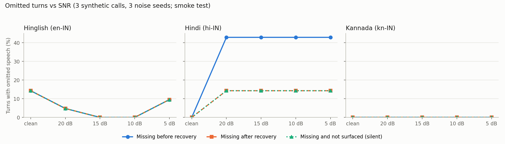

# RecoveryCall QA — final report

**Live demo:** https://recoverycall-qa-711436060077.asia-south1.run.app · **Video:** [`docs/demo.mp4`](demo.mp4) · **Code:** this repository

All calls, names, lenders and amounts in this project are fictional. All audio was synthesized with Gnani Timbre. No real recordings, voice cloning or personal data were used.

## 1. Problem

Debt-recovery calls in India are made at volume, in many languages. The RBI's guidance on recovery agents restricts intimidation, abusive language and threats to contact a borrower's family, employer or neighbours. Compliance teams can listen to only a sample of calls.

Automatic transcription helps, but it has a failure mode that matters a lot for an audit: on noisy phone audio, speech-to-text sometimes **drops whole turns without any error**. A reviewer reading the transcript would never know the threatening sentence was said.

RecoveryCall QA is a review aid, not a judge:
- It points reviewers at the passages worth hearing.
- It shows the exact words and links each one to the audio.
- It is explicit about what it could not transcribe.

There are no risk scores and no verdicts. Every regulatory reference reads "to verify against the RBI circular".

## 2. Pipeline

```
audio (WAV/MP3)
  → ffmpeg decode (16 kHz mono)
  → energy VAD: whole timeline cut at pauses into segments ≤ 12 s (nothing discarded)
  → Gnani Prisma STT per segment (hi-IN / kn-IN / en-IN for Hinglish, format=verbatim)
  → coverage check: transcript characters per VAD speech-second vs a per-language baseline;
      below 0.5 × baseline → re-split at shorter pauses and re-transcribe the pieces;
      still low → "untranscribed speech hh:mm–hh:mm" warning for the reviewer
  → concern tagging:
      rules v1 (frozen)  ∪  Gemini tagger whose quotes must be verbatim in the transcript
      → hybrid flags: potential conduct concerns (intimidation, abusive language,
        third-party contact threat) + authority claims to verify (police, arrest, FIR, court, notice)
  → Gnani Timbre spoken summary in the call's language (template filled from the flags)
```

The app (`app.py` + `static/`) streams the stages to a single page. It shows a waveform with flag pins and hatched low-coverage stretches, a transcript with clickable quotes, findings cards (with rejected AI flags struck through), the spoken summary and a downloadable audit JSON.

## 3. What the spike found (Prisma STT on phone-quality audio)

**Set:** 3 fictional calls (Hinglish, Kannada and Hindi, 7 turns each), synthesized with Timbre and degraded to phone quality: 300–3400 Hz, 8 kHz, G.711 μ-law, plus a version with pink noise at 10 dB SNR.

**Word error rate (12 s chunks, micro-averaged):**
- WER: 0.157 clean, 0.146 phone, 0.283 phone + noise.
- The noise mostly added **deletions**, which went from 6 on clean audio to 31 with noise.
- Romanised Hinglish needs `en-IN`. `hi-IN` answers in Devanagari, so its WER on that call is not comparable.

**Silent omissions.** In the Hindi call with noise, Prisma left out entire turns, including the amount owed and the borrower's "I can't pay this month", and returned HTTP 200 with no error.

**The omission experiment** (`experiment.py`; noise sweep from clean to 5 dB, 3 seeds, 273 turn-instances):
- The coverage check detected 36 of 40 missing turns (90%).
- Re-splitting recovered 24 of 40 (60%).
- It raised no false flags on clean segments (0 of 8).
- After recovery, 16 of 273 turns (6%) were still silently missing.
- The hard remainder is **short turns**: "जी, बताइए।" was dropped in 12 of 13 conditions and never recovered, because two words carry too little speech for a density check.



## 4. Results, in order

Every set below was written externally. Its labels were checked by reading the scripts, logged per call in `label_changes`, and committed before any tagger ran on it. Each set was evaluated once, and nothing was tuned afterwards. Each held-out set was retired after use.

### 4.1 Rules v1 baseline: held-out v1, text only
This is a frozen keyword/regex rule set built on the dev scripts, tested on 20 scripts.
- Conduct recall: **5/17**.
- Conduct false flags on compliant calls: 0/10.
- Authority claims found: 4/6.
- Misses were phrasings the rules had never seen: employer letters, house visits in Hinglish, and most Kannada concerns.
- [details](baseline_rules_v1.md)

### 4.2 Held-out v2: text only, rules vs LLM vs hybrid
20 scripts were tagged on text.

| method | conduct recall | compliant false flags | authority verify flags found |
|---|---|---|---|
| Rules | 0/11 | 0/12 | 3/7 |
| LLM | 11/11 | 0/12 | 6/7 |
| Hybrid | 11/11 | 0/12 | 6/7 |

- The quote verifier rejected 0 of 19 LLM quotes.
- Caveats: the set had no Hindi concerning calls, and its "en-IN" scripts were plain English.
- [details](held_out_v2_results.md)

### 4.3 Held-out v3: end-to-end on audio
18 calls, run once on 2026-10-22:
- 6 per language (Hindi, Kannada, Hinglish), 3 concerning and 3 compliant in each. All 9 compliant calls are hard negatives: late fees with a legal-notice process, settlement deadlines, credit-bureau and guarantor clauses.
- Each call was synthesized turn by turn with Timbre, degraded to phone quality (with and without 10 dB noise), and run through the app's own pipeline.
- [full results](held_out_v3_results.md)

| audio | method | conduct concerns found | compliant false flags | authority verify flags found (false) |
|---|---|---|---|---|
| phone | rules v1 | 0/15 | 0/9 | 2/6 (0) |
| phone | LLM / hybrid | **15/15** | **0/9** | 6/6 (0) |
| phone + 10 dB noise | rules v1 | 0/15 | 0/9 | 2/6 (0) |
| phone + 10 dB noise | LLM / hybrid | **15/15** | **0/9** | 6/6 (1) |

**What this shows, and what it doesn't:**
- **Tagging held up through real STT.** The hybrid found every labelled concern in every language, on both audio versions, with no conduct false flags on the 9 lawful-but-firm calls. The quote verifier rejected 0 of 45 LLM quotes: every quote was verbatim in the Prisma transcript.
- **The rules contribute almost nothing on unseen phrasing.** Rules v1 found 0 of 15, as on v2. The hybrid's recall is the LLM's.
- **One STT error became a false verify flag.** In the noisy Hinglish call HX002, Prisma heard "Phir complaint mat karna" ("don't complain later") as "phir complaint baat karenge". The LLM then flagged it as an authority claim to verify. The reviewer sees the quote and can dismiss it, but the cause is upstream of the tagger.
- **The omission safeguard was barely tested, and it missed the one omission.**
  - Prisma dropped 1 of 216 turn-instances: the borrower's 12-word reply in the Hindi call HI002 (phone version, no added noise), together with the start of the agent's next sentence.
  - The 11 s segment's character density stayed above the threshold, so nothing was flagged and the omission was silent.
  - The coverage check flagged 0 of 106 segments in this run.
  - The abusive-language flag still fired from the surviving half of the agent's sentence.
  - Here the noisy version of that call was transcribed more completely than the clean one; omissions are not a simple function of noise.
- **Scale.** 18 calls cover 6 situations × 3 languages, the concerns are fairly explicit, and the Kannada scripts await native review. These results support "works on clear cases in all three languages", not a production accuracy figure.

**Cost of the run:** 108 Timbre TTS, 106 Prisma STT and 34 Gemini requests, with 0 failed requests, in 534 s.

## 5. Limitations

- **Synthetic audio.** Timbre speech is clean and regular, with one speaker per turn. There is no crosstalk, no real line noise and no regional accents beyond the voices. Real calls will be harder.
- **Small sets.** The sets are 20, 20 and 18 calls, and v3's 18 calls are 6 situations each written in 3 languages. One call moves a recall figure by 10–30 points, so these are smoke tests, not benchmarks.
- **Short-turn omissions.** The coverage check cannot see a dropped two- or three-word turn, because there is too little speech to judge. Those can still go missing silently.
- **Kannada is pending native review.** The Kannada scripts, labels and summary template were written and checked without a native speaker.
- **No speaker separation.** Prisma's REST response has no diarization or word timestamps. The taggers see both sides of the call, and a borrower quoting a threat could be flagged.
- **Call-level scoring.** A flag of the right type anywhere in the call counts as found.
- **LLM dependence.** The hybrid's recall comes almost entirely from Gemini on the free tier. If it times out or errors, the app falls back to rules-only flags and says so on the page.
- **The prompt was written after reading dev data.** Dev numbers are optimistic and are never reported as results.

## 6. Privacy and safety design

- **Fictional data only.** The page and the post say so, and there is no voice cloning.
- **No persistence.** Uploads go to a per-request temporary directory that is deleted before the response ends. The browser plays its own local copy, and the audit JSON is built in the browser.
- **Live analysis behind a passcode,** with per-IP rate limits (rightmost `X-Forwarded-For` hop), 20 MB and 2-minute caps, and a single Cloud Run instance with a ₹100 budget alert.
- **Secrets:**
  - API keys live in Secret Manager in production and `.env` locally (git-ignored).
  - They are sent only in request headers and are never logged.
  - Logs contain counts and timings only, and a log audit found no key, passcode or transcript text.
- **Third-party data flow is disclosed.** The page states that live analysis sends the transcript to Google Gemini.
- **Evidence, not verdicts:**
  - Every flag quotes the transcript verbatim, and an LLM quote that isn't verbatim is rejected and shown as rejected.
  - Wording is fixed: "potential conduct concern — human review required", authority claims are "to verify", and regulatory references are "to verify against the RBI circular".
  - There is no risk score.
- **Gaps are surfaced.** Low-coverage stretches are hatched on the waveform and listed as findings.

## 7. How Gnani Prisma and Timbre are used

| Gnani model | where | how |
|---|---|---|
| **Prisma STT** (`POST /stt/v3`, `format=verbatim`) | every analysis | VAD segments ≤ 12 s, `hi-IN` / `kn-IN` / `en-IN` (Hinglish → Latin script). Low-density segments are re-split and re-sent (recovery). Retries 429/5xx with backoff and never retries 400/403. |
| **Timbre TTS v2.5** (`POST /api/v1/tts/inference`) | test data | every fictional call, synthesized per turn: Hemraj/Chitra (hi-IN), Kavin/Saanvi (kn-IN), Poorvi/Pranav (hi-en), 16 kHz WAV |
| **Timbre TTS v2.5** | every analysis | a spoken summary in the call's language (Hemraj, Kavin, Pranav). It is a fixed template, with numbers written as words per the Timbre guidance. |

A cached bundled example costs 0 API calls. A live analysis of a 20 s call took 7 calls (5 Prisma, 1 Gemini, 1 Timbre) and 8.3 s on Cloud Run.

## 8. Demo

- **Live:** https://recoverycall-qa-711436060077.asia-south1.run.app. The four cached examples need no passcode, and live runs need one.
- **Video:** [`docs/demo.mp4`](demo.mp4) (59 s).
- **Run locally:** see the README (`RCQA_MOCK=1` runs fully offline).
